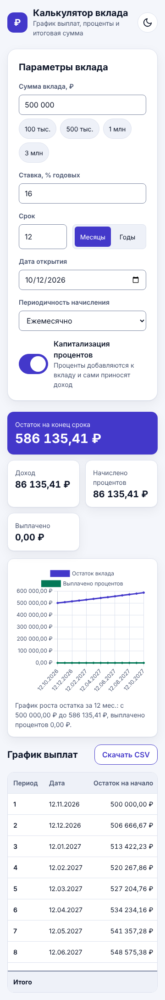
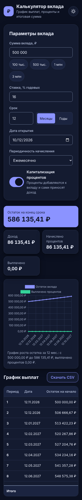
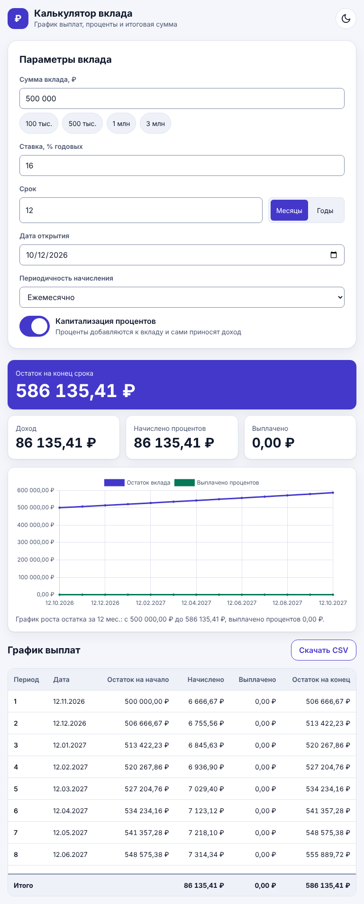
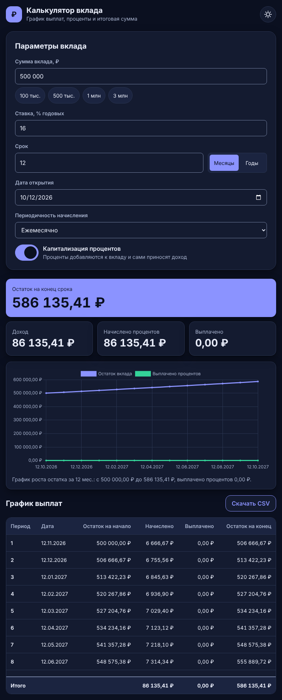
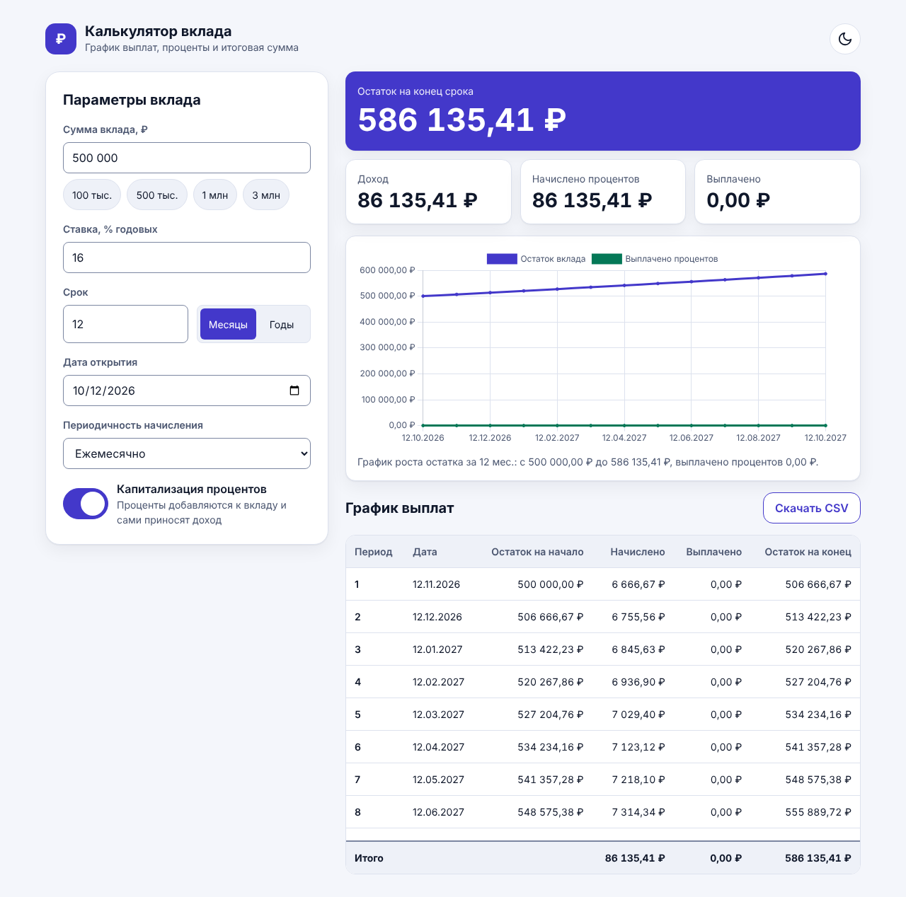
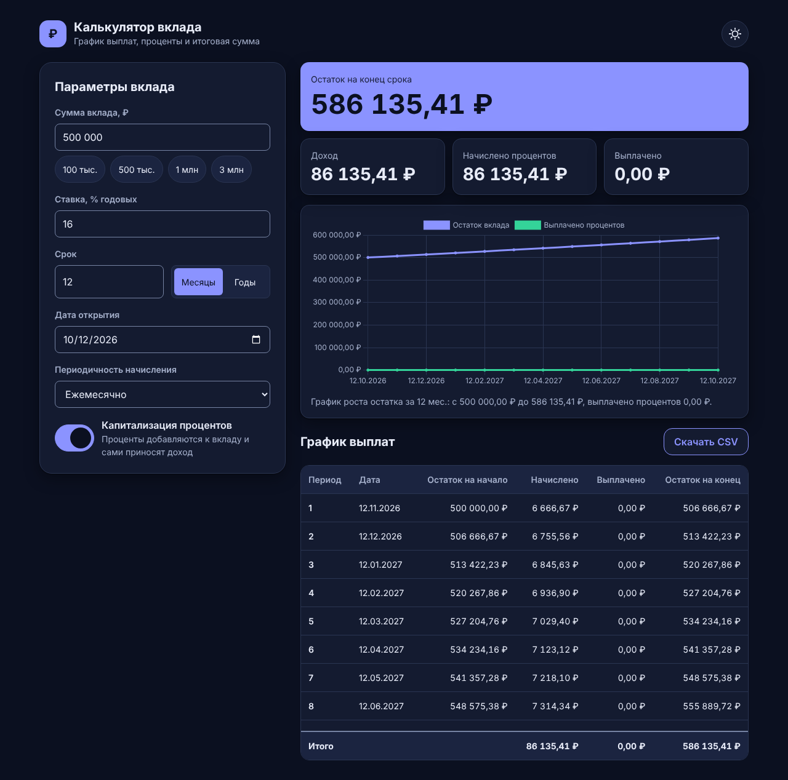

# Калькулятор выплат по вкладу

Красивое веб-приложение на Vue: по сумме, ставке и сроку показывает график выплат по вкладу
(простые и сложные проценты, разная периодичность), итоги, интерактивный график роста остатка
и позволяет выгрузить таблицу в CSV.

Учебный проект, показывающий правильную разработку с помощью ИИ:
спецификация в [OpenSpec](https://github.com/Fission-AI/OpenSpec) → план → тесты → код.

## Процесс

1. Требования оформляются как изменение в `openspec/changes/`.
2. Спецификация проверяется командой `openspec validate --strict`.
3. После утверждения спецификации сначала пишутся тесты, затем реализация.
4. Завершённое изменение архивируется (`openspec archive`), требования попадают в `openspec/specs/`.

## Как выглядит

Светлая и тёмная темы, три ширины экрана (скриншоты снимаются командой `npm run docs:screens`).

| Ширина | Светлая тема | Тёмная тема |
| --- | --- | --- |
| 360 px |  |  |
| 768 px |  |  |
| 1280 px |  |  |

Публикация: https://prixodik.github.io/deposit-calculator/ (после включения GitHub Pages с источником «GitHub Actions»).

## Запуск

```
npm install
npm run dev          # режим разработки
npm test             # модульные тесты (Vitest)
npm run test:e2e     # сквозные тесты и проверка доступности (Playwright, axe)
npm run typecheck    # проверка типов
npm run check:bem    # проверка имён классов по БЭМ
npm run build        # сборка
```

Требуется Node.js 22.12 или новее. Для сквозных тестов нужен браузер Chromium
(`npx playwright install chromium`).

## Допущения расчёта

- Деньги считаются только в `decimal.js`, без `number`.
- Месяц равен 1/12 года независимо от числа дней: проценты периода = `остаток × ставка / 100 × месяцы / 12`.
- Проценты округляются до копейки по правилу «половина вверх» в каждом периоде, поэтому
  результат помесячной капитализации (112 682,51 ₽ для 100 000 ₽ под 12 % на год) может отличаться
  от замкнутой формулы на копейки.
- Если срок не делится на период нацело, последний период короче.
- Даты окончания периодов считаются от даты открытия; если в месяце нет нужного числа, берётся последний день месяца.

## Процесс разработки с ИИ

1. Требования описаны как изменение OpenSpec, проверены `openspec validate --strict` и утверждены человеком.
2. План разбит на группы задач (`tasks.md`); одна группа — одна ветка и один запрос на слияние.
3. В каждой группе сначала коммит с падающими тестами (названия тестов повторяют сценарии спецификации), затем реализация.
4. Правила для ИИ закреплены в `CLAUDE.md`; проверки (типы, БЭМ, тесты, сборка, сквозные тесты) выполняются в CI.
5. После слияния всех групп изменение архивируется: `openspec archive`.
